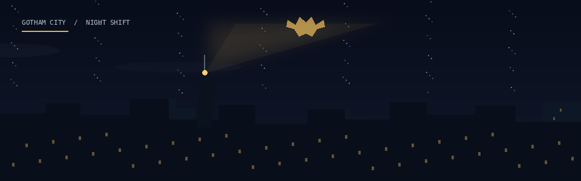

<h1 align="center">Gabriel Alves</h1>

  

  

  <strong>BACKEND DEVELOPER</strong> &nbsp;·&nbsp; Java &nbsp;·&nbsp; Building clean, scalable, reliable applications

  <a href="mailto:alwisgabriel@gmail.com">Email</a>
  &nbsp;·&nbsp;
  <a href="https://instagram.com/alwisgabriel">Instagram</a>

---

<h2 align="center">Selected Projects</h2>

  

| Project | What it is |
| --- | --- |
| [CRM Backend](https://github.com/alwisgabriel/crm-backend) | Backend project |
| [Planejador de viagem](https://github.com/alwisgabriel/planejador-viagem) | Travel planning project |
| [Books 279B](https://github.com/alwisgabriel/Books279B) | Java solution for Codeforces 279B using a sliding window |
| [Enquadra](https://github.com/alwisgabriel/enquadra-preview) | Profile photo adjustment and preview prototype |
| [SENAI Projects](https://github.com/alwisgabriel/SENAI) | Programming exercises and academic projects |

---

GOTHAM TRANSMISSION · END OF LINE

